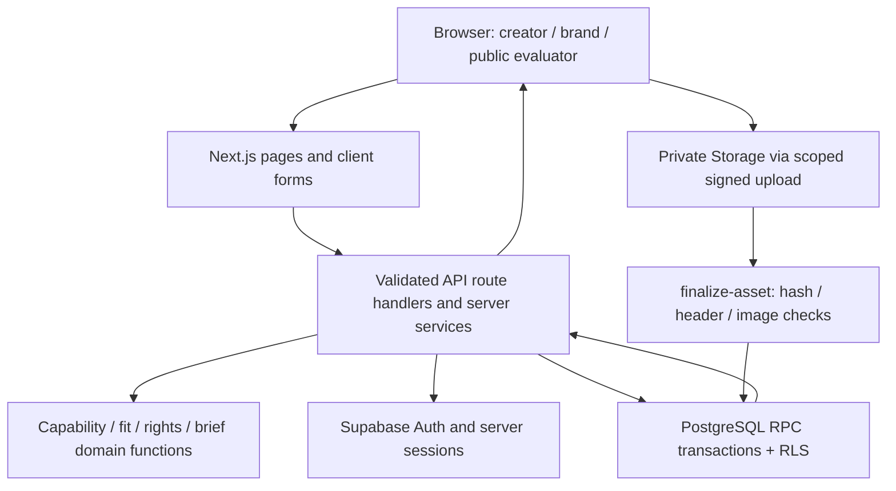

# Creation Mart — Project and Evaluation Guide

A working creator marketplace that connects precise production briefs to creators through production passports, explainable matching, rights fit receipts, and reviewed private delivery. Brands can evaluate how work is made, why a creator fits, and which declared uses are supported before selecting a creator.

**Live website:** [https://creation-mart.vercel.app](https://creation-mart.vercel.app) · **Public overview:** [Features and architecture](https://creation-mart.vercel.app/project-overview) · **Source:** [GitHub main](https://github.com/Ritesh004-kira/Creation-Mart/tree/main)

Updated 14 October 2026. This guide describes the implemented CM-2.0 application. Source references are provided for independent inspection. Release verification is tracked separately in [docs/evaluation-release.md](docs/evaluation-release.md). Older run-state and handoff documents describe earlier checkpoints.

## Read this project quickly

Start with the four USPs below, follow the seven-step walkthrough, then inspect the architecture and linked source. The public website provides the same catalog without requiring an account. Use `/llms.txt` for a complete plain-text overview and `/project-overview.json` for structured feature, route and evidence metadata. Authenticated journeys require separate creator and brand accounts; public browsing does not require access to private evidence.

## Four implemented USPs

### U1 · Production Passports

Published portfolio items combine real media previews with declared skills, tools, model pipeline, workflow, capabilities, usage offers and supporting claim evidence. The reserve → upload → finalize → publish pipeline checks actual bytes, hashes, media headers and image dimensions. Evidence can become stale when the underlying work changes. Public portfolio visibility and private evidence access are controlled separately.

**Try it:** [/creators](https://creation-mart.vercel.app/creators)

**Implementation:** [src/domain/passport.ts](https://github.com/Ritesh004-kira/Creation-Mart/blob/main/src/domain/passport.ts), [src/server/services/portfolio.ts](https://github.com/Ritesh004-kira/Creation-Mart/blob/main/src/server/services/portfolio.ts), [supabase/functions/finalize-asset/index.ts](https://github.com/Ritesh004-kira/Creation-Mart/blob/main/supabase/functions/finalize-asset/index.ts), [supabase/migrations/20261013105048_portfolio_assets.sql](https://github.com/Ritesh004-kira/Creation-Mart/blob/main/supabase/migrations/20261013105048_portfolio_assets.sql)

### U2 · Explainable Brief Fit

SQL-backed creator discovery supports text, specialties, skills, tools, models, media kinds, formats, aspect ratios, styles, languages, availability, budget, currency and rights state. Brief-aware eligibility checks capability combinations, not unrelated individual tags. Fit-v1 exposes outcomes (35), style (20), workflow (15), format (15), availability (5), and evidence (10) terms. Applicable weights are normalized into a score with component numerators, denominators and reasons. Brands persist private shortlists and compare up to three creators.

**Try it:** [/creators](https://creation-mart.vercel.app/creators)

**Implementation:** [src/domain/fit-score.ts](https://github.com/Ritesh004-kira/Creation-Mart/blob/main/src/domain/fit-score.ts), [src/domain/capability-fit.ts](https://github.com/Ritesh004-kira/Creation-Mart/blob/main/src/domain/capability-fit.ts), [src/server/services/discovery.ts](https://github.com/Ritesh004-kira/Creation-Mart/blob/main/src/server/services/discovery.ts), [supabase/migrations/20261013123954_discovery_rights.sql](https://github.com/Ritesh004-kira/Creation-Mart/blob/main/supabase/migrations/20261013123954_discovery_rights.sql)

### U3 · Rights Fit Receipts

A reproducible receipt compares the brief's requested commercial use, paid ads, modifications, source files, exclusivity, training use, attribution, territories and duration with creator declarations, model references and final delivery permissions. Each rule identifies its source and explanation. Outcomes are compatible_declared, needs_review or blocked. SQL and TypeScript implementations are covered by parity fixtures; final acceptance checks actual submission scope and permissions.

**Try it:** [/creators](https://creation-mart.vercel.app/creators)

**Implementation:** [src/domain/rights-fit.ts](https://github.com/Ritesh004-kira/Creation-Mart/blob/main/src/domain/rights-fit.ts), [tests/unit/rights.test.ts](https://github.com/Ritesh004-kira/Creation-Mart/blob/main/tests/unit/rights.test.ts), [supabase/migrations/20261013123954_discovery_rights.sql](https://github.com/Ritesh004-kira/Creation-Mart/blob/main/supabase/migrations/20261013123954_discovery_rights.sql), [supabase/migrations/20261013174127_acceptance_asset_scope_guard.sql](https://github.com/Ritesh004-kira/Creation-Mart/blob/main/supabase/migrations/20261013174127_acceptance_asset_scope_guard.sql)

### U4 · Executable Brief Copilot

A persistent six-section brief builder turns a rough objective into editable production requirements covering outputs, creative direction, workflow, rights, budget and deadline. Deterministic template assistance identifies missing fields and conflicting constraints, reports readiness, and preserves user-controlled edits. Publication compiles stable requirement IDs for quantity, format, dimensions, duration, content and rights. These requirements are reused for delivery mapping and specific revision requests.

**Try it:** [/briefs/new](https://creation-mart.vercel.app/briefs/new)

**Implementation:** [src/domain/brief-compiler.ts](https://github.com/Ritesh004-kira/Creation-Mart/blob/main/src/domain/brief-compiler.ts), [src/app/briefs/[id]/edit/brief-builder.tsx](https://github.com/Ritesh004-kira/Creation-Mart/blob/main/src/app/briefs/[id]/edit/brief-builder.tsx), [src/app/api/v1/brief-assist/route.ts](https://github.com/Ritesh004-kira/Creation-Mart/blob/main/src/app/api/v1/brief-assist/route.ts), [supabase/migrations/20261013114531_briefs_marketplace.sql](https://github.com/Ritesh004-kira/Creation-Mart/blob/main/supabase/migrations/20261013114531_briefs_marketplace.sql)

## Full feature inventory

### Identity and accounts

Email signup, password sign-in, GitHub OAuth callbacks, password recovery and authenticated password changes; permanent creator/brand onboarding; preserved internal return destinations; server-validated sessions and role-aware dashboards.

**Implementation:** [src/app/sign-in/sign-in-form.tsx](https://github.com/Ritesh004-kira/Creation-Mart/blob/main/src/app/sign-in/sign-in-form.tsx), [src/app/auth/callback/route.ts](https://github.com/Ritesh004-kira/Creation-Mart/blob/main/src/app/auth/callback/route.ts), [src/app/auth/confirm/route.ts](https://github.com/Ritesh004-kira/Creation-Mart/blob/main/src/app/auth/confirm/route.ts), [src/server/auth/require-user.ts](https://github.com/Ritesh004-kira/Creation-Mart/blob/main/src/server/auth/require-user.ts)

### Creator workspace and portfolio

Persist creator profile, capability pairs, production workflow and rights offer. Create, edit, preview and publish portfolio items and profile. Upload image, video, audio and text assets, inspect file checks, manage supporting claim evidence and retry expired previews.

**Implementation:** [src/app/creator/profile/profile-form.tsx](https://github.com/Ritesh004-kira/Creation-Mart/blob/main/src/app/creator/profile/profile-form.tsx), [src/components/portfolio/asset-uploader.tsx](https://github.com/Ritesh004-kira/Creation-Mart/blob/main/src/components/portfolio/asset-uploader.tsx), [src/components/portfolio/evidence-manager.tsx](https://github.com/Ritesh004-kira/Creation-Mart/blob/main/src/components/portfolio/evidence-manager.tsx), [src/components/media/asset-view.tsx](https://github.com/Ritesh004-kira/Creation-Mart/blob/main/src/components/media/asset-view.tsx)

### Brand workspace and production briefs

Persist company details, create/save/reload/edit/publish structured briefs, browse published briefs, inspect candidates in the context of the actual brief, persist shortlists and compare candidates.

**Implementation:** [src/app/brand/company-form.tsx](https://github.com/Ritesh004-kira/Creation-Mart/blob/main/src/app/brand/company-form.tsx), [src/app/briefs/new/page.tsx](https://github.com/Ritesh004-kira/Creation-Mart/blob/main/src/app/briefs/new/page.tsx), [src/components/briefs/brief-collection.tsx](https://github.com/Ritesh004-kira/Creation-Mart/blob/main/src/components/briefs/brief-collection.tsx), [src/app/briefs/[id]/shortlist/shortlist-view.tsx](https://github.com/Ritesh004-kira/Creation-Mart/blob/main/src/app/briefs/[id]/shortlist/shortlist-view.tsx)

### Applications and selection

Creators apply to the current published brief revision and can withdraw. The brand reviews applications and selects one winner atomically. Engagement creation freezes trusted brief, creator and rights snapshots so later profile edits do not silently change the agreed scope.

**Implementation:** [src/app/briefs/[id]/apply/application-form.tsx](https://github.com/Ritesh004-kira/Creation-Mart/blob/main/src/app/briefs/[id]/apply/application-form.tsx), [src/app/briefs/[id]/applications/select-application.tsx](https://github.com/Ritesh004-kira/Creation-Mart/blob/main/src/app/briefs/[id]/applications/select-application.tsx), [supabase/migrations/20261013131042_engagement_workflow.sql](https://github.com/Ritesh004-kira/Creation-Mart/blob/main/supabase/migrations/20261013131042_engagement_workflow.sql)

### Versioned delivery and acceptance

Upload ready assets, map files to output requirements and submit immutable delivery versions. Brands request revisions against specific requirements; creators submit a new version. Acceptance requires the latest eligible submission, correct asset ownership/scope and final permissions. Only participants can obtain accepted final download links.

**Implementation:** [src/app/engagements/[id]/page.tsx](https://github.com/Ritesh004-kira/Creation-Mart/blob/main/src/app/engagements/[id]/page.tsx), [src/components/engagements/delivery-actions.tsx](https://github.com/Ritesh004-kira/Creation-Mart/blob/main/src/components/engagements/delivery-actions.tsx), [src/components/engagements/download-file.tsx](https://github.com/Ritesh004-kira/Creation-Mart/blob/main/src/components/engagements/download-file.tsx), [supabase/migrations/20261013174127_acceptance_asset_scope_guard.sql](https://github.com/Ritesh004-kira/Creation-Mart/blob/main/supabase/migrations/20261013174127_acceptance_asset_scope_guard.sql)

### Responsive and accessible experience

Responsive landing, discovery, forms and workspace pages; keyboard skip link, visible focus, native menu/film dialogs, Escape dismissal and restored focus; reduced-motion support and pauseable background film; navigation progress, loading indicators, retry controls, upload progress and error recovery.

**Implementation:** [src/app/globals.css](https://github.com/Ritesh004-kira/Creation-Mart/blob/main/src/app/globals.css), [src/app/workspace.css](https://github.com/Ritesh004-kira/Creation-Mart/blob/main/src/app/workspace.css), [src/components/ui/navigation-progress.tsx](https://github.com/Ritesh004-kira/Creation-Mart/blob/main/src/components/ui/navigation-progress.tsx), [src/components/landing/film-button.tsx](https://github.com/Ritesh004-kira/Creation-Mart/blob/main/src/components/landing/film-button.tsx)

### Authorization and integrity

Database row-level security and grants restrict ownership and participant access. Private storage, short-lived signed access, strict request schemas, bounded request bodies, same-origin write guards, optimistic versions, actor-scoped idempotency, quotas and protected database fields enforce workflow rules beyond the UI. Cancelled upload blockers prevent replay until signed-link expiry.

**Implementation:** [src/server/http/body.ts](https://github.com/Ritesh004-kira/Creation-Mart/blob/main/src/server/http/body.ts), [src/server/http/app-origin.ts](https://github.com/Ritesh004-kira/Creation-Mart/blob/main/src/server/http/app-origin.ts), [supabase/migrations/20261013131316_workflow_security_fixes.sql](https://github.com/Ritesh004-kira/Creation-Mart/blob/main/supabase/migrations/20261013131316_workflow_security_fixes.sql), [supabase/migrations/20261013174930_cancelled_upload_replay_guard.sql](https://github.com/Ritesh004-kira/Creation-Mart/blob/main/supabase/migrations/20261013174930_cancelled_upload_replay_guard.sql)

## End-to-end walkthrough

1. Public evaluator: open /creators, filter the network and inspect a published creator's portfolio, production passport and declared usage offer.
2. Creator: sign up or sign in, select the creator role during onboarding, complete the profile, add real work and supporting evidence, inspect the checked preview, then publish the portfolio and profile.
3. Brand: use a separate account with the brand role, save company details, create a six-section brief, resolve readiness issues, save and publish it.
4. Brand: open creator discovery in the brief context, inspect fit component explanations and rights receipts, save a shortlist and compare up to three candidates.
5. Creator: open the current brief, apply and describe the proposed pipeline. Brand: review applications and select one creator to create an engagement.
6. Creator: upload and submit v1 against output requirements. Brand: inspect delivery and request a requirement-specific revision. Creator: submit v2.
7. Brand: review the latest version and final permissions, accept the delivery and download the accepted files privately. An unrelated account must not be able to access the delivery.

Use separate browser profiles for the two roles. Demo-account secrets are intentionally absent from the repository and public guide. New users can create their own accounts. Maintainers can use `node scripts/account-access.mjs` on the authorized Windows workstation; explicit copy actions place selected existing demo credentials on the clipboard without logging their values.

## Architecture



| Layer | Technology | Responsibility | Source |
|---|---|---|---|
| Presentation | Next.js 15 App Router, React 19, TypeScript, Tailwind CSS 4 | Server-rendered pages and client forms; role-aware navigation and responsive interaction. | [src/app](https://github.com/Ritesh004-kira/Creation-Mart/tree/main/src/app) |
| HTTP and sessions | Next.js /api/v1 route handlers, Supabase SSR, Zod | Validated request/response contracts, safe redirects, user validation, origin/body limits and error mapping. | [src/server](https://github.com/Ritesh004-kira/Creation-Mart/tree/main/src/server) |
| Domain logic | Deterministic TypeScript functions | Capability matching, fit-v1 scoring, rights evaluation, media parsing and brief requirement compilation. | [src/domain](https://github.com/Ritesh004-kira/Creation-Mart/tree/main/src/domain) |
| Persistence and transactions | Supabase PostgreSQL; 14 versioned migrations | Profiles, portfolios, briefs, applications, shortlists, engagements, submissions and event records; RPC transitions, RLS, version and concurrency guards. | [supabase/migrations](https://github.com/Ritesh004-kira/Creation-Mart/tree/main/supabase/migrations) |
| Media processing | Private Supabase Storage + finalize-asset Edge Function | Reserve/upload/finalize lifecycle, file hash/header/image checks, ready asset state and authorized signed reads. | [supabase/functions/finalize-asset](https://github.com/Ritesh004-kira/Creation-Mart/tree/main/supabase/functions/finalize-asset) |
| Hosting | Existing Vercel project, Node 22 | Production build, server-rendered web app and HTTP route handlers at the canonical domain. | [vercel.json](https://github.com/Ritesh004-kira/Creation-Mart/tree/main/vercel.json) |

### Data model

accounts links Auth identity to an immutable role. creator_profiles and brand_profiles store role-specific identity. portfolio_items owns assets and claim_signals. briefs owns its requirements, applications and shortlists. Winning application selection creates an engagement with frozen snapshots. submissions stores immutable delivery versions; workflow_events records transitions. catalog_terms supports shared facets and model references; idempotency_keys protects repeat mutations.

### Critical transaction flows

- Upload: reserve an owned asset and quota → upload to its scoped private path → finalize actual bytes → mark ready → publish or map to a submission. Cancelled paths remain blocked until signed-upload expiry.
- Matching: validate filters → apply exact eligibility → calculate normalized fit components → evaluate declaration-based rights → return stable results and explanations.
- Selection: verify owning brand/current brief and application versions → choose one winner atomically → freeze engagement snapshots.
- Delivery: submit owned ready assets against requirements → store immutable version → request referenced revisions → accept latest eligible version → authorize private final read.

## Routes and access

| Route | Access | Function |
|---|---|---|
| `/` | Public | Product landing, core USPs and real navigation. |
| `/project-overview` | Public | Complete evaluator guide, features, architecture, source map and limitations. |
| `/creators and /creators/:slug` | Public / brief context where authorized | Discovery, portfolio passports, fit breakdown and rights receipts. |
| `/sign-in, /onboarding, /account/password` | Public auth / authenticated | Account creation, role assignment and account security. |
| `/dashboard, /creator, /brand` | Authenticated; role-specific | Owned profiles, briefs, applications and engagements. |
| `/creator/profile, /creator/preview, /portfolio/new, /portfolio/:id/edit` | Creator | Profile and portfolio editing, evidence, preview and publication. |
| `/briefs, /briefs/:id` | Published brief visibility / ownership rules | Browse and inspect production requirements. |
| `/briefs/new, /briefs/:id/edit, /briefs/:id/shortlist, /briefs/:id/applications` | Owning brand | Brief creation/publication, candidate comparison and winner selection. |
| `/briefs/:id/apply` | Creator | Current-revision application. |
| `/engagements/:id` | Participants | Submissions, revisions, acceptance and private final downloads. |
| `/api/v1/health` | Public | Database-backed readiness and active assistance mode. |
| `/llms.txt and /project-overview.json` | Public | Plain-text and machine-readable versions of this documentation. |

## HTTP API map

- /api/v1/me/creator and /me/brand: profile persistence; /me/creator/publish: publication.
- /api/v1/portfolio-items and /portfolio-items/:id/publish: portfolio editing and publication; /claims: supporting evidence.
- /api/v1/assets/reserve, /assets/:id/read-url and /assets/:id/cleanup: private media lifecycle and scoped read links.
- /api/v1/creators and /creators/:slug: discovery and creator detail.
- /api/v1/brief-assist and /brief-assist/:id: template assistance; /briefs and /briefs/:id/publish: structured briefs.
- /api/v1/briefs/:id/shortlist and /shortlist/:creatorId: persistent candidate selection.
- /api/v1/briefs/:id/applications, /applications/:id/withdraw and /applications/:id/select: application lifecycle.
- /api/v1/engagements/:id/submissions, /request-revision and /accept: guarded delivery transitions.

The API source is in `src/app/api/v1`; strict schemas are in `src/domain/contracts`; SQL RPCs and database guards are in `supabase/migrations`. Mutations enforce server-side identity and database-level ownership rather than trusting hidden buttons.

## Local setup and commands

Use Node.js 22 and the committed npm lockfile. Copy `.env.example` to `.env.local` and configure the existing Supabase public URL/key and application origin. Never put privileged service keys in public environment variables.

```sh
npm ci
npm run dev
npm run typecheck
npm run lint
npm run test:unit
npm run build
```

`npm run start` serves a production build. `npm run test:e2e` runs browser suites. Hosted `scripts/test-*.mjs` require authorized scoped test accounts and can create fixtures; read their scope before running. `npm run smoke:deployment -- https://creation-mart.vercel.app` checks public readiness, routes and basic authorization behavior. A new database requires the committed migrations and the finalizer deployment; linking it is distinct from merely supplying public environment variables.

## Evidence and evaluation scope

- Historical baseline evidence: docs/verification.md records 70 unit cases and hosted identity, discovery, rights parity, security, acceptance and signed-upload replay probes; the canonical two-role journey reached accepted exact-byte private downloads.
- October 14 implementation review: docs/implementation-review-2026-10-14.md records new email/account/UI checks and explicit gaps in later local full-journey retries. Historical evidence is not a claim that every current user path was retested.
- Before this documentation update, the synchronized main source passed TypeScript, ESLint and an optimized production build. This documentation release is checked with build/lint/unit commands and public URL checks as recorded in docs/evaluation-release.md.
- Tests and scripts are inspectable in tests/unit, tests/e2e and scripts/test-*.mjs. Browser screenshots and workflow evidence are in docs/evidence. docs/capability-ledger.md and docs/requirements-checklist.md map baseline requirements to evidence.

## Honest implementation boundaries

- Brief Copilot is deterministic template assistance. Optional model inference is disabled; no live LLM generation, paid model API or AWS worker is claimed.
- Rights receipts compare declarations and references; they do not grant legal clearance. File checks do not verify identity, authorship, licensing or malware safety.
- Fictional demo creators and procedural media are explicitly labeled. The initial seed records 12 creators, 24 media items, two brands and three briefs; later tests add scoped fixtures, so these are seed counts rather than live totals.
- 3D is metadata and poster support; the app does not render 3D models. Media duration/content reviews can require brand review rather than automated byte-level validation.
- Payments, escrow, subscriptions, social-platform publishing, follower analytics, blockchain receipts and scope-change orders are outside the implemented workflow.
- Email confirmation/recovery delivery depends on the existing Supabase mail setup. The recorded Free-project advisory reports leaked-password protection disabled.
- AWS IAM setup is documented as configured and policy-simulated, with no live operator session or active compute. Older run-state and deployment IDs are historical snapshots; use docs/evaluation-release.md for this release.

## Documentation index

- [Architecture and data flow](docs/architecture.md)
- [Evaluation guide](docs/evaluation-guide.md)
- [Current documentation release](docs/evaluation-release.md)
- [Historical verification](docs/verification.md)
- [Capability ledger](docs/capability-ledger.md)
- [Requirements checklist](docs/requirements-checklist.md)
- [October 14 implementation review](docs/implementation-review-2026-10-14.md)
- [Third-party notices](THIRD_PARTY_NOTICES.md)
- [Cleanup and resource scope](docs/resource-cleanup.md)

The public documentation catalog is generated from `src/content/project-overview.json`. The website renders it as ordinary server-generated HTML, with matching public JSON and plain text for machine readers.
