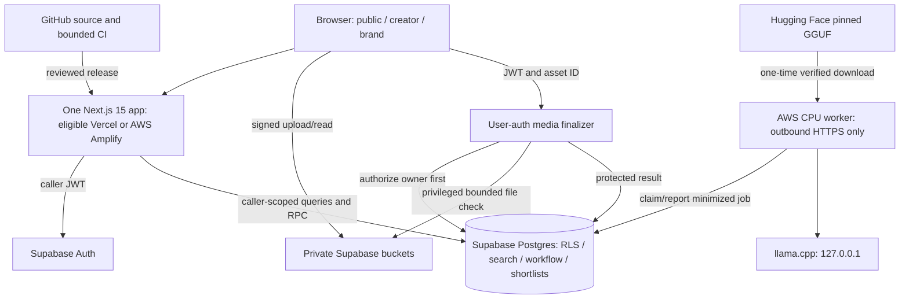

# Execution_Access_And_Deployment.md

> Infrastructure/access authority. Research is read-only: no user account, target repository, hosted database or AWS deployment was changed. Connected tool definitions are not proof of credentials, write permission, plan eligibility or a successful release.

## Shared contract — CM-2.0

**Target:** CreatorMatch, one end-to-end AI creator marketplace built in 15 hours by an experienced engineer using Codex. **Research date:** 13 October 2026. This is a proposed implementation contract, not a built product or production certification.

**One app / one identity / one database:** Next.js 15 App Router, Node 22, React, TypeScript, Tailwind 4, accessible Radix/CVA primitives, Zod, Supabase Auth/Postgres/private Storage/one finalizer Edge Function, GitHub, Vitest and Playwright. Resolve current security-patched compatible versions and pin lockfiles.

**Reuse:** a small original application with selected MIT components/patterns from JobHorizons, selected domain ideas from Freelancezero, and a rewritten CreatorBrief AI brief module. Do not merge their whole backends, auth systems, schemas or package manifests. PromptHub and Collabry remain reference-only unless a usable license is subsequently established.

**Four USPs:** U1 AI Production Passport (Workflow Proofcards); U2 Explainable Brief Fit; U3 Rights Fit Receipts; U4 Executable Brief Copilot. Ranking weights: outcomes 35, style 20, workflow 15, format 15, availability 5, evidence completeness 10; normalized over applicable dimensions.

**Integrations:** Supabase and GitHub are core. Vercel Hobby hosts only if actual use meets personal/non-commercial terms; otherwise AWS Amplify under verified eligible credits, or local hosting. Optional AWS CPU inference downloads pinned Qwen2.5-0.5B-Instruct GGUF from Hugging Face. No Instagram, YouTube, TikTok, social scraping, follower analytics, external posting, paid generation API, payments, subscriptions or purchased domain.

**AI:** immediate deterministic draft; optional outbound-only AWS worker claims minimized Supabase jobs. One inference at a time, 256 output tokens, 15-second inference budget, 20-second total deadline, strict schema validation and no automatic overwrite. Core discovery never calls a model.

**Trust/rights:** claim-specific creator_declared / evidence_attached / platform_checked / independently_verified. Rights results: compatible_declared / needs_review / blocked. Technical metadata, a hash, OAuth login and a model assessment do not prove authorship, legal identity or licensing.

**Security:** RLS on every exposed table; ownership/participant guards, private buckets, signed URLs, protected system columns, strict uploads and transactional transitions. No Supabase service key in browser, Next.js host or AWS worker; privileged media checks stay in the Edge Function.

**Budget:** no purchase/upgrade/trial workaround. Verify actual AWS credit balance, expiry, covered services and uncovered charges before spending. $5 gross planning envelope, one worker, maximum 24-hour lifetime; alerts are not a hard billing cap.

### Authority and file dependencies

Read [Plan.md](Plan.md) first. [Implementation_Specification.md](Implementation_Specification.md) owns product/data/API/UI contracts. [Execution_Access_And_Deployment.md](Execution_Access_And_Deployment.md) owns permissions, security deployment and cost gates. [Code_USPS.md](Code_USPS.md) owns the four mechanisms, tests and demos. [Repository_Reuse_And_Verification.md](Repository_Reuse_And_Verification.md) owns upstream pins, licensing and extraction decisions. These **five files only** are the active implementation pack; older CM-1.0 documents and repos.md are research inputs, not competing instructions. Human instructions and enforced platform permissions take precedence. Preserve security and zero-purchase constraints when resolving a conflict; record the resolution before coding.


## 1. Architecture and responsibilities



Supabase owns identity/data/media. GitHub owns code/CI. AWS owns optional inference and, when needed, alternative hosting. HF is artifact download, not paid inference. Vercel is one possible host, not an entitlement to commercial deployment.

No social connector or posting integration belongs in this graph. No public worker port, GPU, NAT Gateway, ALB, RDS, OpenSearch, SageMaker or third-party paid API. The model never sees evidence/media/licenses or privileged keys.

## 2. Autonomy envelope: configure once, then execute

When the user asks Codex to implement this pack, infer ordinary reversible engineering tasks and approved demo deployment within the provided scope. Do not repeatedly request approval for coding, tests, scoped seeds or an already-authorized host.

Before external writes record nonsecret bindings:
```json
{
  "baseline": "CM-2.0",
  "runId": "generated UUID",
  "repository": "verified owner/repo",
  "branch": "implementation branch",
  "supabaseProjectRef": "verified dedicated hackathon project",
  "awsAccountId": "verified account",
  "awsRegion": "verified selected region",
  "host": "local|vercel_eligible|amplify_credit_eligible",
  "authorizedActions": [],
  "creditCoverageVerified": false,
  "awsGrossPlanningLimitUsd": 5,
  "workerExpiresAt": "UTC within 24 hours",
  "purchasesPermitted": false
}
```

Reuse a suitable authorized repository/project. If the implementation instruction permits creating dedicated disposable resources, choose reasonable names independently, verify Free/credit coverage, and record IDs; do not mutate unrelated resources. Multiple ambiguous existing targets require a target decision, not guessing.

A zero-human-interference guarantee is impossible if authentication, OAuth consent, MFA, organizational permission or credit information is missing. These are real external boundaries. Complete code/local tests/deployment artifacts first, bundle missing prerequisites in one concise request, and continue independent work. Never use elapsed time as approval.

## 3. Connector permissions and fallback paths

Current research could discover AWS/GitHub/Supabase/Vercel tool definitions. Authentication and permission tests on the user's accounts were deliberately not performed for document authoring.

| Resource | Minimum read capability | Authorized implementation write capability | Fallback |
|---|---|---|---|
| GitHub | Identity, repo/branch/files, workflow status | Selected contents/branch/PR if requested, workflow definitions, deployment vars/secrets through secure setters | Local Git commits and prepared push if write/auth absent |
| Supabase | Organization/project/plan, schema/migrations, publishable key, advisors | Dedicated Free project where authorized, migrations, Edge deploy, provider config, controlled seed | Authorized CLI or tested local stack; do not upgrade |
| AWS | Caller/account/region/quotas/pricing/credit coverage | Tagged single instance/disk/SG/profile, exact PassRole, SSM; Amplify app only if chosen | Local/template when credit or privileges unresolved |
| Vercel | Plan/project/team/deployment state | Eligible project, nonsecret env, deploy | Amplify under covered credits or local |
| HF | Public repo/revision/license/files | No account mutation for public download | Verified cache; otherwise template |
| Browser/CUA | Authorized local/deployed web app | Demo-account actions only | Playwright with actual endpoint; report missing visual verification |

Prefer purpose-built authenticated connectors, inspect their live schemas and target IDs, and use authenticated CLIs only when permitted. A Supabase cost-confirmation tool is not permission to choose a paid plan. A deploy tool returning an operation/job ID is not a READY deployment.

Never request secret values in chat or print them. If a provider only exposes a credential through a user-controlled secure setting, ask the user to configure that setting. Do not substitute broad administrator access for a narrowly missing permission.

## 4. Platform limits, restrictions and cost gates

### 4.1 Public limits checked, account remainder unknown

| Platform | Relevant documented condition | Configuration |
|---|---|---|
| Supabase Free | 500 MB DB, 1 GB Storage, 50,000 MAU, 2 active projects; 50 MB platform upload ceiling; 5 GB egress plus separately listed 5 GB cached egress; 500,000 Edge invocations | One project; app stricter uploads; seed <100 MB; stop reservations at 700 MB; no paid transforms/branching/PITR |
| Supabase default email | Team-authorized recipients and currently 2/hour | GitHub OAuth or pre-provisioned real password accounts; no magic-link/SMTP purchase dependency |
| Vercel Hobby | Personal/non-commercial only; 100 GB data transfer, 10 GB origin transfer, 1M CDN/function requests, 4 active CPU hours and 360 GB-hours memory | Thin web app, no model/media proxy; actual use eligibility required |
| GitHub Free private repo | 2,000 standard-runner minutes/month, 500 MB artifacts, 10 GB cache/repo | Standard Linux; ≤250 minute target; <100 MB evidence with short retention |
| AWS promotional credit | Covers designated eligible service charges only; expiry and excess/ineligible charges matter | Verify account-specific EC2/EBS/IPv4/transfer/Amplify coverage before activation |
| HF | Chosen public model downloadable; hosting not free by implication | Pin/download/cache locally on covered AWS resources |

Sources: [Supabase pricing](https://supabase.com/pricing), [SMTP](https://supabase.com/docs/guides/auth/auth-smtp), [Vercel Hobby](https://vercel.com/docs/plans/hobby), [GitHub Actions billing](https://docs.github.com/en/billing/concepts/product-billing/github-actions), [AWS credits](https://aws.amazon.com/awscredits/).

Vercel financial-gain definition means a marketplace/demo/prize entry is not automatically permitted just because payments are absent. If eligibility is uncertain, choose the other authorized host; do not buy Pro or start a paid trial. [Fair use](https://vercel.com/docs/limits/fair-use-guidelines).

An existing AWS account cannot assume new-customer free allowances. Account credit balance, expiry, covered services, taxes/uncovered charges and competing usage must be checked. If cash charges cannot be ruled out under the user's constraint, do not activate that configuration. [AWS Free Tier](https://docs.aws.amazon.com/awsaccountbilling/latest/aboutv2/free-tier.html).

### 4.2 CPU worker and realistic inference

Default candidate: one Linux c6i.large, 2 vCPU/4 GiB, provided its verified regional quote is ≤$0.10/hour and the instance/associated services are credit-covered. The $0.10 is a **deployment price ceiling, not a quoted current price**. Fixed CPU avoids T3 CPU-credit throttling/surplus surprises. C6i shape is documented by AWS. [C6i](https://aws.amazon.com/ec2/instance-types/c6i/).

Fallback t3.medium only if benchmark passes with Standard credits explicitly selected; never silently enable Unlimited. No GPU or larger automatic upgrade.

10 GB encrypted gp3; no snapshots; public subnet/auto IPv4 for outbound HTTPS, **zero inbound SG rules**; internet gateway without NAT. SSM administration, IMDSv2 required. Non-root worker; fixed model/server pins; local inference at 127.0.0.1:8081. Tags Project=CreatorMatch, Environment=hackathon, RunId and ExpiresAt. One instance, no autoscaling, max24h lifetime.

### 4.3 Cost illustration, not billing guarantee

For 24h at compute ceiling $0.10/h, IPv4 $0.005/h, 10 GB gp3 illustration $0.08/GB-month (720h month): worker ≤$2.5467 before transfer/tax. Current selected-region EBS quote must be verified. [IPv4](https://aws.amazon.com/vpc/pricing/), [EBS](https://aws.amazon.com/ebs/pricing/).

Amplify public standard rates: build $0.01/min, storage $0.023/GB-month, transfer $0.15/GB, SSR $0.30/million requests and $0.20/GB-hour. Example 60 build minutes, 1 GB transfer, 0.1 GB stored/day, 1,000 SSR requests and 1 GB-hour compute ≈$0.9504. Combined example ≈$3.4971, before transfer/tax variations and other account use. [Amplify pricing](https://aws.amazon.com/amplify/pricing/).

Calculations were performed programmatically. No credits/new-account freebies were assumed in the gross example. $5 is a planning envelope, not an enforced provider cap. AWS Budgets can update 8–12 hours apart and cannot alone protect a 15h event. [Budget update timing](https://docs.aws.amazon.com/cost-management/latest/userguide/budgets-managing-costs.html).

Controls: immutable one-instance ceiling, job/input/output quotas, storage reservations, build limits, feature kill switch, expiry timer and cleanup of run-tagged resources. Stop/termination failures must be surfaced. EBS/app storage can continue charging after compute stops; confirm removal of disposable resources.

## 5. IAM and secrets

Separate operator, EC2 worker and hosting roles. No root login, unrestricted PassRole or copied administrator policy.

Worker trust:
```json
{
  "Version": "2012-10-17",
  "Statement": [{
    "Effect": "Allow",
    "Principal": {"Service": "ec2.amazonaws.com"},
    "Action": "sts:AssumeRole"
  }]
}
```

Worker uses SSM core permissions only; no IAM/EC2/S3 admin or Supabase service key. Operator PassRole is exact instance-role ARN with iam:PassedToService=ec2.amazonaws.com. Mutable EC2/SSM permissions scope to selected resources/VPC/documents/tags; actions without resource-scoped read support may need wildcard only for reads. Render and validate actual ARNs/condition support, not imagined policies. [PassRole](https://docs.aws.amazon.com/IAM/latest/UserGuide/id_roles_use_passrole.html), [SSM instance permissions](https://docs.aws.amazon.com/systems-manager/latest/userguide/session-manager-getting-started-instance-profile.html).

EC2 Session Manager is documented without additional session charge; do not enable paid just-in-time/hybrid features. [SSM pricing](https://aws.amazon.com/systems-manager/pricing/). Only approved ephemeral worker termination may be automated. Preserve unrelated IAM/resources and respect managed infrastructure ownership.

| Value | Location |
|---|---|
| Supabase URL/publishable key | Browser/web host; intentionally public |
| Supabase privileged key/client | Finalizer built-in env; temporary controlled bootstrap, never web runtime/worker |
| Worker credentials | Root-owned /etc/creatormatch/worker.env or approved secret-preserving provisioning path; never user-data/log/model context |
| OAuth secret | Supabase provider settings |
| GitHub/hosting/deploy credentials | Connected auth or protected reviewed deployment process |
| HF token | Omitted for public selected repo |
| AWS credentials | Short-lived connector/CLI session, never committed |

Amplify SSR artifacts should receive only nonsecret allowlisted env values; built files can be read by users with artifact access. This architecture therefore places no service key in Next.js. [Amplify SSR env guidance](https://docs.aws.amazon.com/amplify/latest/userguide/ssr-environment-variables.html).

## 6. RLS, Storage and privileged finalization

Enable RLS before exposing every table. Own reads/writes for private profiles/drafts/evidence; public safe read for published profiles/items/catalogs; published safe brief payload authenticated; shortlist owner brand; applications owner creator or owning brand; engagements/submissions/events exact participants. Never expose private files by inheriting portfolio publicity.

Column grants and mandatory triggers enforce immutable ownership, role, snapshots and technical fields. UPDATE needs SELECT/USING/WITH CHECK. Search uses invoker visibility. Definer wrappers are narrow, schema-qualified, empty-search-path and precise caller checks, with default PUBLIC execute revoked. The worker allowlist cannot be acquired through onboarding or metadata.

Finalizer uses current Supabase user-auth mechanism with verify_jwt=true, an owner-scoped query and only then privileged file operations. A 401 is diagnosed, not fixed by disabling verification. [Edge auth](https://supabase.com/docs/guides/functions/auth). Privileged finalization does not imply broad web-admin APIs.

Reject invalid/oversize bytes and unsafe types; no in-place upsert. Reservations enforce 700 MB project/120 MB user/three-pending/30-active and retain rejected allocation until actual deletion. Signed URLs are narrow capabilities with short expiry; do not log/cache them publicly or proxy private media through image optimization. Use direct unoptimized/native media URLs. [RLS](https://supabase.com/docs/guides/database/postgres/row-level-security), [Storage](https://supabase.com/docs/guides/storage/security/access-control).

Web headers: nosniff, frame-ancestors none, object-src none, safe referrer policy and a tested framework-compatible CSP. Allow the exact Supabase host for media/images/connections plus necessary local blob/data previews; do not inherit upstream media-src none or wildcard connect-src. Use production nonce/hash handling supported by the pinned Next15 release, keeping development-only unsafe-eval out of production. Nonces require appropriate rendering/caching behavior; test OAuth, scripts, media and every deployed page before enabling the final policy. Follow current guidance but adapt proxy examples to Next15 middleware.ts. [Next.js CSP guidance](https://nextjs.org/docs/app/guides/content-security-policy). User-supplied reference URLs are never fetched by the finalizer/web server; that avoids introducing an arbitrary URL-fetch/SSRF surface. [OWASP SSRF](https://community.owasp.org/attacks/Server_Side_Request_Forgery).

## 7. Model artifact and job protocol

Verified HF repo:
- Qwen/Qwen2.5-0.5B-Instruct-GGUF
- revision `9217f5db79a29953eb74d5343926648285ec7e67`
- `qwen2.5-0.5b-instruct-q4_k_m.gguf`
- Apache-2.0 metadata; preserve actual license/notice and verify download hash.

[Publisher card](https://huggingface.co/Qwen/Qwen2.5-0.5B-Instruct-GGUF), [public model API](https://huggingface.co/api/models/Qwen/Qwen2.5-0.5B-Instruct-GGUF). This license does not clear all generated-output rights.

```bash
hf download Qwen/Qwen2.5-0.5B-Instruct-GGUF   qwen2.5-0.5b-instruct-q4_k_m.gguf LICENSE README.md   --revision 9217f5db79a29953eb74d5343926648285ec7e67   --local-dir /opt/creatormatch/model
```

Pin reviewed hf/llama.cpp versions; inspect their command help and protocol. Local health and /v1/chat/completions only. Fixed system prompt, 2048 context, ≤1024 input tokens, ≤256 output, temperature0.2, JSON grammar/schema supported by pinned release; validate AiBriefPatchV1 again. [Grammar limits](https://github.com/ggml-org/llama.cpp/blob/master/grammars/README.md).

enqueue_ai_job authenticates brand, minimizes input, checks private ai_enabled/quota and20-sec deadline. claim_ai_job asserts worker scope, locks unexpired queued row SKIP LOCKED, attempts=1 and unique lease; returns only allowed fields. report checks same worker/lease/state/deadline. No direct client update. Worker JWT refresh is bounded. A hung generation is cancelled or server restarted; an HTTP timeout alone must not leave CPU work running.

Poll active visible jobs every2sec until deadline, then stop. Draft revision changes invalidate output. Eight varied real jobs plus timeout/invalid/stale/denied-user tests are required before enabling. A schema-valid response is not quality proof; human accepts fields. If utility/latency fails, disable and record actual limitation.

## 8. Commands and release sequence

Command examples are templates, not already executed deployment. Use actual CLI help/version and approved bindings.

Local:
```powershell
node --version
npm ci
npm run typecheck
npm run lint
npm run test:unit
npm run build
npm run dev
```

Supabase:
```powershell
npx supabase --version
npx supabase migration new identity_catalog
npx supabase migration new portfolio_assets
npx supabase migration new briefs_marketplace
npx supabase migration new discovery_rights
npx supabase migration new optional_ai
npx supabase migration new security_review
npx supabase link --project-ref $env:SUPABASE_PROJECT_REF
npx supabase db push --dry-run
npx supabase db push
npx supabase functions deploy finalize-asset --project-ref $env:SUPABASE_PROJECT_REF
```
Use authorized migration/Edge connectors instead when available, not both paths. Never reset hosted production. Generate DB types from actual schema and run advisors/direct-role probes.

Web env:
```dotenv
NEXT_PUBLIC_SUPABASE_URL=https://verified-project.supabase.co
NEXT_PUBLIC_SUPABASE_PUBLISHABLE_KEY=configured-public-key
APP_ORIGIN=http://localhost:3000
BASELINE_VERSION=CM-2.0
DEMO_MODE=true
```
DEMO_MODE labels seed data, never disables auth. AI enablement is authoritative private DB configuration; UI capability response mirrors it.

Vercel eligible:
```powershell
vercel link
vercel deploy
vercel inspect $env:VERIFIED_DEPLOYMENT_URL
```
Confirm exact project/team/commit and READY; test protected URLs with the permitted mechanism. Production assignment follows existing authorization, not an automatic claim from successful preview creation.

Amplify fallback: use GitHub-linked Next.js hosting/default HTTPS hostname. Current documentation supports through Next.js15, so use patched15 rather than inherit PromptHub16. [Support](https://docs.aws.amazon.com/amplify/latest/userguide/ssr-amplify-support.html).
```yaml
version: 1
frontend:
  phases:
    preBuild:
      commands:
        - npm ci
    build:
      commands:
        - node scripts/write-public-build-env.mjs
        - npm run build
  artifacts:
    baseDirectory: .next
    files:
      - '**/*'
  cache:
    paths:
      - node_modules/**/*
      - .next/cache/**/*
```
Env script writes only allowlisted nonsecret fields; no full env dump. Start release on verified app/branch with connector or aws amplify start-job; wait for actual status and test hostname. OAuth/repository consent, if absent, is an unavoidable boundary.

Worker provisioning script must verify identity/quote/credit plan, render tagged launch input with 10GB encrypted gp3/IMDSv2/no-ingress/exact profile, show plan, launch only if authorized, install reviewed runtime without secrets in user-data, establish expiry and test. No invented AMI/instance IDs or assumed SSM connectivity.

Release order: migrations/grants → advisors/probes → finalizer and upload check → bounded seed → reviewed web commit → exact callback/refresh → live workflow/security/visual tests → optional worker real tests → capability ledger/demo/expiry. No model deployment before core security works.

## 9. CI/CD and observability

One deploy path: Git integration OR CLI, not competing automatic releases. Standard Linux runner,15-min timeout/job, cancel superseded branch runs, reviewed pinned action SHAs. Default contents:read; grant deployment capability only to reviewed authorized branch. PR tests carry no management/service secrets. Do not assume paid environment-review/deployment-check features.

Scripts: typecheck/lint/unit/build; SQL/RLS integration locally when Docker available; hosted security smoke with designated demo users; Playwright critical path. Target≤250 private runner minutes; artifacts<100MB/1-day retention; local equivalent if quota exhausted. Repository publicity requires user authorization.

Logs: requestId/operation/status/duration/sanitized error; no briefs/credentials/signed URLs/raw model responses/evidence. DB events show actual mutations. Worker logs job/model revision/time/result; size capped. Measure search, page usability, upload success, AI validity/deadline misses and reserved storage. No paid tracing/drains/analytics dependency.

## 10. Approval boundaries, recovery and cleanup

Independent authorized work continues. Stop dependent action only for missing login/MFA/OAuth/credentials; ambiguous target; denied write/IAM privilege; unverified cash exposure; unrelated destructive data change; platform automatic rejection. Do not bypass restrictions, widen RLS or fabricate results. Report the exact action/reason. Purchasing/upgrading remains forbidden.

After each checkpoint save commit, migration IDs, resource IDs, host URL/status, flags, tests and next task in run-state/checkpoints. On resume inspect actual state; avoid duplicate resources/migrations/seeds.

Recovery: diagnose after2–3 failures, change approach; use additive forward fixes, not remote resets; leave drafts intact on upload/model failure; return409/reload on conflicts; use last passing release for regressions. A recording is labeled presentation evidence.

At agreed worker expiry remove only run-tagged disposable resources; verify instance termination, auto IPv4 release/root-volume cleanup, and delete unused Amplify app after approved demo window. Timer/stop alone does not prove billing stopped. Keep source and allowed evidence; revoke worker scope/credentials. If cleanup fails, report it clearly.

