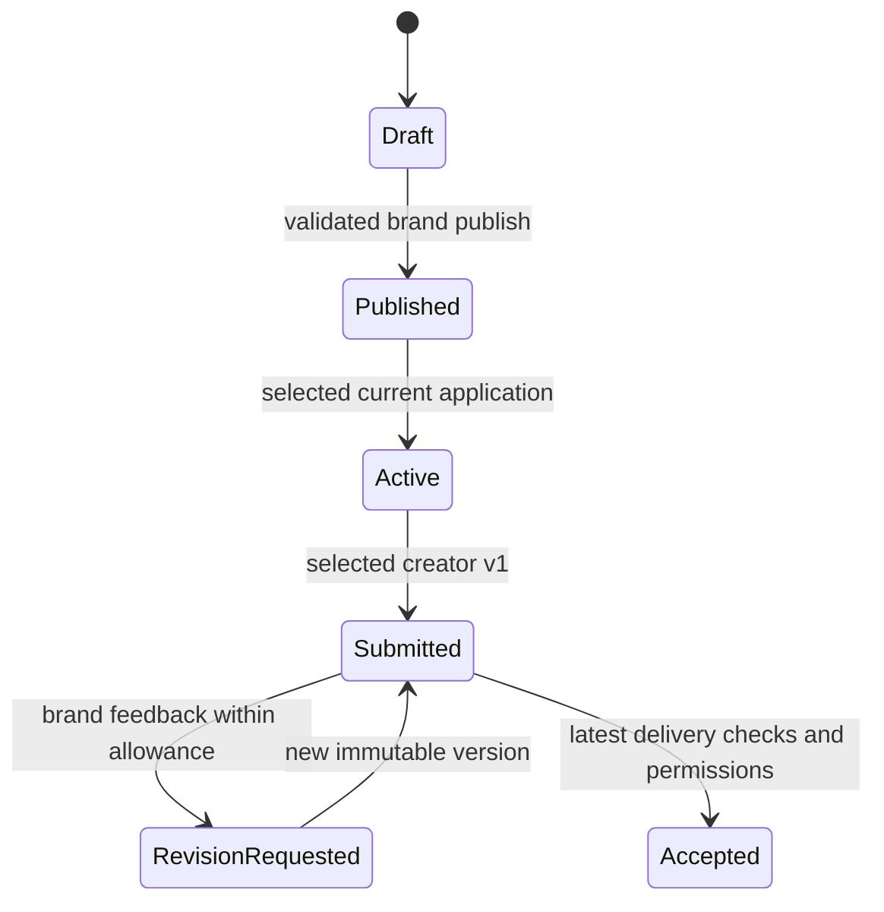

# Implementation_Specification.md

> Product and engineering authority for CM-2.0. Deliver a complete hackathon prototype with industry-informed safeguards. Do not describe 15 hours of engineering as production validation or guarantee “100% intuitive” usability.

## Shared contract — CM-2.0

**Target:** CreatorMatch, one end-to-end AI creator marketplace built in 15 hours by an experienced engineer using Codex. **Research date:** 13 October 2026. This is a proposed implementation contract, not a built product or production certification.

**One app / one identity / one database:** Next.js 15 App Router, Node 22, React, TypeScript, Tailwind 4, accessible Radix/CVA primitives, Zod, Supabase Auth/Postgres/private Storage/one finalizer Edge Function, GitHub, Vitest and Playwright. Resolve current security-patched compatible versions and pin lockfiles.

**Reuse:** a small original application with selected MIT components/patterns from JobHorizons, selected domain ideas from Freelancezero, and a rewritten CreatorBrief AI brief module. Do not merge their whole backends, auth systems, schemas or package manifests. PromptHub and Collabry remain reference-only unless a usable license is subsequently established.

**Four USPs:** U1 AI Production Passport (Workflow Proofcards); U2 Explainable Brief Fit; U3 Rights Fit Receipts; U4 Executable Brief Copilot. Ranking weights: outcomes 35, style 20, workflow 15, format 15, availability 5, evidence completeness 10; normalized over applicable dimensions.

**Integrations:** Supabase and GitHub are core. Vercel Hobby hosts only if actual use meets personal/non-commercial terms; otherwise AWS Amplify under verified eligible credits, or local hosting. Optional AWS CPU inference downloads pinned Qwen2.5-0.5B-Instruct GGUF from Hugging Face. No Instagram, YouTube, TikTok, social scraping, follower analytics, external posting, paid generation API, payments, subscriptions or purchased domain.

**AI:** immediate deterministic draft; optional outbound-only AWS worker claims minimized Supabase jobs. One inference at a time, 256 output tokens, 15-second inference budget, 20-second total deadline, strict schema validation and no automatic overwrite. Core discovery never calls a model.

**Trust/rights:** claim-specific creator_declared / evidence_attached / platform_checked / independently_verified. Rights results: compatible_declared / needs_review / blocked. Technical metadata, a hash, OAuth login and a model assessment do not prove authorship, legal identity or licensing.

**Security:** RLS on every exposed table; ownership/participant guards, private buckets, signed URLs, protected system columns, strict uploads and transactional transitions. No Supabase service key in browser, Next.js host or AWS worker; privileged media checks stay in the Edge Function.

**Budget:** no purchase/upgrade/trial workaround. Verify actual AWS credit balance, expiry, covered services and uncovered charges before spending. $5 gross planning envelope, one worker, maximum 24-hour lifetime; alerts are not a hard billing cap.

### Authority and file dependencies

Read [Plan.md](Plan.md) first. [Implementation_Specification.md](Implementation_Specification.md) owns product/data/API/UI contracts. [Execution_Access_And_Deployment.md](Execution_Access_And_Deployment.md) owns permissions, security deployment and cost gates. [Code_USPS.md](Code_USPS.md) owns the four mechanisms, tests and demos. [Repository_Reuse_And_Verification.md](Repository_Reuse_And_Verification.md) owns upstream pins, licensing and extraction decisions. These **five files only** are the active implementation pack; older CM-1.0 documents and repos.md are research inputs, not competing instructions. Human instructions and enforced platform permissions take precedence. Preserve security and zero-purchase constraints when resolving a conflict; record the resolution before coding.


## 1. Required outcome and scope

A creator signs in, completes a production-oriented profile, uploads work/process evidence and publishes. A brand signs in, defines precise outputs and usage requirements, publishes a brief, finds suitable creators using actual database records, compares and saves a shortlist. A creator applies. The brand selects an eligible application. The creator submits, the brand requests a revision, the creator resubmits, and the brand reviews/accepts/downloads the final delivery. All durable state survives refresh.

**P0, finish by H8:** auth, profiles/portfolios/passports, database discovery and filters, structured briefs/readiness, rights receipts, persistent shortlists, coherent responsive navigation.
**P1, finish by H11:** applications, atomic selection, engagement snapshots, submissions/revision/acceptance, private final downloads.
**P2, bounded H11–H12:** actual AWS brief enrichment if credentials/credits/performance permit. Always retain deterministic assistance.

No payment placeholders that look operational. No social-account connection screens, follower counts, projected reach, social tokens, publication APIs, influencer outreach or platform-specific campaign fields. GitHub OAuth is authentication through an available resource; it does not connect a social-media publishing account.

## 2. Roles and authorization

| Role/context | Rights |
|---|---|
| Visitor | Read safe published creator work/catalogs; search; signed reads of publishable ready previews |
| Creator | Own profile/items/evidence; authenticated published briefs; own applications; selected engagements/submissions |
| Brand | Own company context/draft briefs/shortlists; applications to its briefs; own engagement reviews |
| Reviewer | Private allowlist, scoped claim review; not a user-selectable signup role |
| Worker | Private allowlist; minimized AI claim/report only, no privileged DB/media key |
| Finalizer | Edge user-auth handler first checks owner; privileged client then checks that stored asset only |

One-time creator/brand role is stored in accounts. User-editable JWT metadata cannot grant roles. No role-switch UI or shared public demo account endpoint. Fresh onboarding and existing demo accounts follow the same actual authorization rules.

## 3. Page map: every page has a purpose and return path

| Route | Actor | Required content/action | Connected destinations |
|---|---|---|---|
| `/` | All | Clear product proposition, sample work from DB, Browse creators, Start a brief | /creators; /briefs/new or sign-in |
| `/sign-in` | Visitor | GitHub OAuth; provisioned demo password login when configured; clear errors | safe returnTo; onboarding; dashboard |
| `/auth/callback` | Auth | PKCE exchange, safe same-origin redirect | onboarding/dashboard/authorized returnTo |
| `/onboarding` | Unonboarded user | Choose creator or brand once; short required form | role dashboard |
| `/dashboard` | Auth | Role-aware redirect | /creator; /brand |
| `/creator` | Creator | Profile readiness, portfolio, available briefs, own applications and engagements | profile edit; work edit; briefs; engagements |
| `/creator/profile` | Creator | Profile/capability/rights form, save, publish, own preview | /creator; /creator/preview; public profile after publish |
| `/creator/preview` | Creator | Authorized preview of own draft, publication issues | profile/work editor |
| `/portfolio/new`, `/portfolio/:id/edit` | Owner creator | Media upload, workflow, models/tools, human contribution, evidence/rights | creator dashboard; own preview; published detail |
| `/creators` | All | Real discovery with URL filters; brand's brief context when authorized | creator detail; compare; brief |
| `/creators/:slug` | All | Work gallery, passport, declared capabilities, fit/rights when permitted | back to preserved search; shortlist; application context |
| `/brand` | Brand | Draft/published briefs, persistent shortlists, applicants and delivery work | brief builder/detail; discover; engagements |
| `/briefs/new`, `/briefs/:id/edit` | Owner brand | Six-step structured builder and immediate assistance | owner brief detail; discover after publish |
| `/briefs` | Auth | Creator: available published briefs; brand: own briefs | detail/apply/edit |
| `/briefs/:id` | Authorized auth | Safe brief specification, application or owner management | apply; applicants; discover; shortlist; engagement |
| `/briefs/:id/apply` | Creator | Quote/schedule/pipeline/rights declaration and submit | own applications; brief |
| `/briefs/:id/applications` | Owner brand | Real applicant list, receipts, select | creator detail; engagement |
| `/briefs/:id/shortlist` | Owner brand | Saved candidates, compare max three, unavailable-record handling | discover; detail; applicants |
| `/engagements/:id` | Participants | Frozen requirements, versions, feedback, actions and final files | dashboards; original brief; creator profile |
| `/not-found`, error/loading boundaries | Appropriate | Explain recovery without exposing inaccessible records | role dashboard or public browse |

Implement actual routes, not clickable tiles leading to unfinished pages. “Select creator” exists only for an application, not arbitrary discovery cards. Before applications exist, brand actions are Shortlist, Compare, View brief and Copy brief link. Copying a link does not send a message to anyone.

Public nav order: Browse creators → How it works (the implemented /#how-it-works home section) → Sign in/dashboard. Role nav order is consistent across pages. Context bar shows current brief and Back to brief when discovery is brief-driven. Browser Back restores search query/facets/page via URL. Breadcrumbs and back links preserve authorized context. Reject external, protocol-relative and unrelated returnTo paths.

## 4. UI design and understandable states

Use a restrained light editorial interface: background #F7F8FC, surface #FFFFFF, text #111827, muted #4B5563, accent #6D28D9, border #D1D5DB. Validate actual contrast rather than assume these combinations always pass. System/local fonts avoid runtime font services. Headings 32/24/20 px; body 16 px; 8 px spacing scale; 12 px card radius. Avoid inherited glass blur, animated backgrounds, hidden premium filters or decorative charts.

Desktop: 1200 px max content, 280 px filter rail, 3 portfolio cards. Tablet: 2 cards. Mobile 375 px: 1 card and filter drawer; required actions stay visible without hiding keyboard focus. Use native media controls, posters and click-to-play; never autoplay a grid of video.

Single primary action per state. Explicit labels: “Creator declared,” “Evidence attached,” “File checked,” “Needs rights review,” “Draft,” “Published,” “Changes requested,” “Accepted.” No jargon such as RLS or RPC in product copy. Do not display universal “verified creator,” “copyright safe” or “guaranteed match.”

All forms have labels, required markers, inline examples and a summary linking to invalid fields. All modal/drawer controls support Escape, focus trap and focus restoration. Icon-only actions have accessible names. Upload progress, save status, loading, empty, expired session, unauthorized/not-found and retry states must exist. Respect reduced motion.

Navigation accessibility follows W3C's consistent-navigation and focus visibility principles; a checklist is not accessibility certification. [Consistent navigation](https://www.w3.org/WAI/WCAG22/Understanding/consistent-navigation.html), [Focus not obscured](https://www.w3.org/WAI/WCAG22/Understanding/focus-not-obscured-minimum.html).

**UI completion gate:** a first-time tester can find creator work, understand the evidence label, publish a valid brief, recover from zero results and identify the next delivery action without a developer explaining the page. Record failures and fixes; do not claim universal understanding from one test.

## 5. Canonical contracts

### 5.1 Conventions and bounds

UUID IDs, UTC RFC3339 timestamps, integer optimistic versions, strict JSON with no unknown keys. Money is integer minor units plus ISO currency; INR 20,000 = 2,000,000 paise. Indicative creator price basis is project, not hourly. Never convert currencies silently.

Request body ≤32 KB; search q ≤160 characters; name 2–80; headline 10–120; bio 30–1500; description/notes ≤2000; arrays ≤20; portfolio workflow ≤12 steps; brief ≤10 output groups. HTTPS reference links are data, not server-fetch targets.

Enums:
```ts
type Role = "creator" | "brand";
type MediaKind = "image" | "video" | "audio" | "text" | "three_d";
type ClaimStatus = "creator_declared" | "evidence_attached"
  | "platform_checked" | "independently_verified";
type RightsResult = "compatible_declared" | "needs_review" | "blocked";
type AssetPurpose = "portfolio_preview" | "portfolio_source"
  | "evidence" | "brief_reference" | "submission";
type AssetState = "pending" | "ready" | "rejected";
type BriefState = "draft" | "published" | "engaged" | "completed" | "archived";
type ApplicationState = "submitted" | "withdrawn" | "selected" | "rejected";
type EngagementState = "active" | "submitted" | "revision_requested" | "accepted";
```

### 5.2 Creator capabilities and portfolio

```ts
type CapabilityV1 = {
  kind: MediaKind;
  formats: string[];        // catalog formats valid for this kind
  aspectRatios: string[];   // e.g. "9:16", "16:9", "1:1"; [] for text/audio
  maxWidthPx: number | null;
  maxHeightPx: number | null;
  maxDurationSec: number | null; // null unknown, not unlimited
};
type CreatorInputV1 = {
  displayName: string; headline: string; bio: string;
  country: string; timezone: string; languages: string[];
  specialties: string[]; skills: string[]; outcomes: string[]; styles: string[];
  toolSlugs: string[]; modelSlugs: string[];
  capabilities: CapabilityV1[]; // max 12
  minimumPriceMinor: number; currency: string;
  available: boolean; deliveryDays: number; // 1..90
  rightsOffer: RightsOfferV1;
};
type ModelRefV1 = {
  catalogSlug: string | null;
  customName?: string; version: string;
  termsUrl?: string; entitlementDeclaration?: string;
};
type WorkflowStepV1 = {
  id: string; ordinal: number;
  stage: "input" | "generation" | "editing" | "quality_check" | "export";
  toolSlug: string; toolVersion?: string; model?: ModelRefV1;
  description: string; humanAction: string; inputDeclaration: string;
  promptExcerpt?: string; usedAt?: string; termsUrl?: string;
};
type PortfolioInputV1 = {
  title: string; objective: string; description: string; kind: MediaKind;
  previewAssetId: string | null; outputFormats: string[];
  widthPx?: number; heightPx?: number; durationSec?: number;
  outcomes: string[]; styles: string[]; modelRefs: ModelRefV1[];
  workflow: WorkflowStepV1[]; humanContribution: string;
  generationDisclosure: "ai_generated" | "ai_assisted" | "no_ai" | "unknown";
  modelDisclosureNote: string;
  rightsOffer: RightsOfferV1;
  artifactOrigin: "creator_supplied" | "procedural_demo" | "simulated";
};
```

Capability declarations are not verified skill. Multiple capabilities must remain associated: do not match a vertical-image capability and a square-video capability as proof of vertical-video capability.

Profile publication requires required profile fields, an answered rights declaration, ≥1 published item with ready preview and ≥3 complete steps. Each item publication requires ready permitted preview, ≥1 valid step, generationDisclosure, model/tool references or explicit modelDisclosureNote (including unknown/no-model statement), human contribution and rights declaration. Public workflow JSON contains safe excerpts only; full prompts/private releases live in private evidence assets. Procedural demo bytes use no_ai; simulated AI workflow descriptions are illustrative, not a claim that a model generated those bytes.

Images/video/audio/text render with actual media support and fallback poster/text preview. Three_d is a poster plus declared source metadata; binary/interactive 3D is deferred. “3D supported” must not imply a working GLB viewer.

The brief output picker offers image/video/audio/text. Reject commissioning a three_d binary output with a clear unsupported-output message; metadata-only 3D profiles remain browsable. Do not accept a required final format that this version cannot upload/deliver.

### 5.3 Rights contract

```ts
type Permission = true | false | null;
type RightsOfferV1 = {
  schemaVersion: 1;
  commercial: Permission; paidAds: Permission; modifications: Permission;
  sourceFiles: Permission; exclusiveArrangement: Permission; trainingUse: Permission;
  attribution: "required" | "not_required" | "unknown";
  territories: string[]; // ISO country codes or ["WORLD"]
  maxTermDays: number | null; // 36500 only if explicitly offered
  thirdPartyStatus: "clear_declared" | "unknown" | "restricted";
  restrictions: string[]; declarationText: string; declaredAt: string;
};
type RightsRequestV1 = {
  schemaVersion: 1;
  commercial: boolean; paidAds: boolean; modifications: boolean;
  sourceFiles: boolean; exclusiveArrangement: boolean; trainingUse: boolean;
  attributionAccepted: boolean; territories: string[]; termDays: number;
  jurisdictionNotes: string;
};
type RightsReceiptV1 = {
  schemaVersion: 1; overall: RightsResult;
  basis: "declarations_and_references";
  rules: {code: string; expected: string; sourceKind: string; sourceId: string;
    outcome: RightsResult; explanation: string}[];
  generatedAt: string;
};
```

Requested permission + false → blocked; null → needs_review. Unrequested permissions do not penalize. Attribution conflict, explicit term/territory insufficiency or applicable usage prohibition block. Unknown term/territory/third-party clearance/model conditions require review. Catalog conditions must be explicit machine-readable rule codes; do not parse natural-language terms into legal certainty. Conditional entitlement can remain needs_review until documented declaration/brand review; an explicit prohibition cannot be acknowledged away.

Receipts at discovery are provisional offer/sample comparisons; selection uses the specific proposed pipeline; final delivery uses its declarations/files. compatible_declared is not licensed/legally cleared. A needs_review selection requires logged brand acknowledgement; unresolved required permissions still prevent acceptance. Negotiated exclusivity does not prove that no similar AI output can exist.

### 5.4 Brief, requirements and assistance

```ts
type OutputV1 = {
  id: string; label: string; kind: MediaKind; quantity: number; // 1..50
  format: string; widthPx?: number; heightPx?: number;
  aspectRatio?: string; durationSec?: number; maxBytes: number;
  contentRequirements: string;
};
type BriefV1 = {
  schemaVersion: 1;
  title: string; objective: string; audience: string; brandContext: string;
  outcomes: string[]; styles: string[]; preferredWorkflows: string[];
  requiredSkills: string[]; requiredTools: string[]; requiredModels: string[];
  languages: string[]; outputs: OutputV1[];
  budgetMinMinor: number; budgetMaxMinor: number; currency: string;
  dueAt: string; revisionRounds: number; // 0..3
  mustInclude: string[]; mustAvoid: string[]; referenceLinks: string[];
  referenceRightsDeclaration: string; rightsRequest: RightsRequestV1;
};
type RequirementV1 = {
  id: string; outputId?: string;
  kind: "quantity" | "format" | "dimensions" | "duration" | "content" | "rights";
  expected: unknown;
  mode: "file_check" | "brand_review" | "declaration_review";
  required: boolean;
};
type AiBriefPatchV1 = {
  schemaVersion: 1;
  objectiveSuggestion: string; // <=400 chars
  conceptSuggestion: string;   // <=400 chars
  questions: string[];         // <=3, <=120 chars each
};
type FinalRightsV1 = {
  schemaVersion: 1; offer: RightsOfferV1; modelRefs: ModelRefV1[];
  inputs: {description: string;
    source: "brand_provided" | "creator_original" | "third_party" | "generated";
    commercialPermission: Permission;
    release: "not_applicable" | "declared_obtained" | "unknown";
    evidenceAssetId?: string}[];
  limitations: string[]; declaredAt: string;
};
type SubmissionInputV1 = {
  expectedVersion: number; assetIds: string[];
  outputMapping: {outputId: string; assetIds: string[]}[];
  creatorChecklist: {requirementId: string; confirmed: boolean; note?: string}[];
  finalRights: FinalRightsV1;
};
type BrandReviewV1 = {
  expectedVersion: number; submissionId: string;
  checks: {requirementId: string; passed: boolean; note?: string}[];
  rightsResolutionNote: string;
};
```

Publish requires nonempty objective/audience/title, ≥1 outcome and complete output, positive ordered budget, future deadline, revision answer, answered mustInclude/mustAvoid (empty explicitly allowed), rights answers and reference-rights declaration. Image/video dimensions determine exact reduced ratio; entered ratio must agree. Video/audio duration is required. TXT requires content instructions. Three_d binary outputs are rejected in this version. No social platform or projected-reach field.

Readiness = passed applicable completeness checks / total applicable checks ×100, with denominator visible. Missing mandatory checks prevent publication regardless of percentage. Database publishing derives Requirement IDs from output UUID + check code; clients cannot supply arbitrary accepted requirements. Selection freezes the current published revision.

The compiler creates a useful partial draft immediately and asks missing questions; it does not invent budget, dates, consent or permissions. Optional model suggestions require explicit allowAi, bounded output and per-field acceptance. Late/invalid output cannot change a saved draft.

## 6. Database schema and migrations

Only one Supabase SQL migration system. No Prisma/Auth.js/tRPC backend inheritance. Workflow JSON is embedded in portfolio_items to reduce tables/joins. Catalogs share one typed table. Core has 14 application tables; optional AI/private operational state brings the design to 17.

| Table | Required structure |
|---|---|
| accounts | id PK/FK auth.users; display_name; role nullable creator/brand; onboarded_at; created_at; version. Role assignment one-time via guarded onboarding. |
| creator_profiles | user_id PK/FK; unique slug; headline/bio/country/timezone; languages/specialties/skills/outcomes/styles/tool_slugs/model_slugs arrays; capabilities jsonb; derived media_kinds/formats/aspect_ratios/workflow_stages arrays; minimum_price_minor bigint; currency; available; delivery_days; rights_offer jsonb; published false; derived search_text/search_doc; version/time. |
| brand_profiles | user_id PK/FK; company_name/industry/audience/tone/country; version/time. Private owner. |
| catalog_terms | kind,slug composite PK; label; aliases text[]; active; metadata jsonb. Kinds: tool/model/skill/specialty/outcome/style/workflow/format/aspect_ratio/language. Model metadata includes publisher/repository/revision/license URL/check time/commercial status/condition codes. Public read, operator write. |
| portfolio_items | id UUID; creator_id; safe title/objective/description; media_kind; preview_asset_id; output_formats/dimensions/duration; outcomes/styles; workflow jsonb; model_refs jsonb; generation_disclosure/model_disclosure_note; human_contribution; rights_offer; artifact_origin; published false; version/time. |
| assets | id UUID; owner_id; bucket/path UNIQUE; purpose/kind; portfolio_item_id or brief_id or engagement_id as applicable; max_bytes; protected reserved_bytes/actual_bytes/mime/hash/dimensions; declared duration separate from checked duration; state; object_deleted_at; created_at. |
| claim_signals | id UUID; creator_id; item_id nullable; asset_id nullable; claim_code; status; assertion; evidence_asset_ids; reference_urls; checker_id/method/time/limitations; simulated bool; stale bool. Privileged statuses protected. |
| briefs | id UUID; brand_id; state; payload jsonb; derived requirements jsonb; revision/published_revision; created_at/updated_at. |
| applications | id UUID; brief_id; creator_id; brief_revision; quote_minor/currency/delivery_days; note; pipeline jsonb; rights_offer; state/version/time; UNIQUE(brief,creator). |
| shortlists | id UUID; brand_id; brief_id; creator_id; created_at; UNIQUE(brand,brief,creator). Brief owner only. |
| engagements | id UUID; brief_id UNIQUE; application_id UNIQUE; derived brand_id/creator_id; immutable brief/requirements/offer/pipeline/selection-receipt snapshots; review_ack; state; revision_count; version; selected_at/accepted_at. |
| submissions | id UUID; engagement_id; creator_id; sequence; asset_ids; output_mapping/checklist/final_rights; brand_review/feedback; submitted_at; UNIQUE(engagement,sequence). Delivered version immutable. |
| workflow_events | id UUID; brief_id/engagement_id; actor_id; event_type; old/new state; entity_version; bounded details; created_at. Append only, participant/owner read. |
| idempotency_keys | actor_id,operation,key composite PK; request_hash; result_ref; created_at. Controlled action writes; repeated payload returns original, different payload 409. |
| ai_jobs (optional) | id UUID; owner_id; brief/revision; minimized input; state; created/deadline/claimed_at; lease; attempts; model_revision; bounded output/error. Owner status read; guarded enqueue/worker operations. |
| private.operators | user_id,scope composite PK; scope reviewer/worker; enabled; allowed_model. Bootstrap only. |
| private.runtime_config | singleton run config; ai_enabled false; quota/time limits; run_id. Management only; worker/enqueue guarded read. |

Create portfolio_items before assets, then add preview FK to handle the cycle. Required FKs, positive sizes/versions, unique workflow ordinals/step IDs, role/type checks and catalog-kind validation apply in SQL and Zod. Actor/owner IDs come from verified session/trusted rows, not request overrides.

Migrations created using the installed CLI's `migration new`:
1. identity_catalog: accounts/profiles/catalog; one-time onboarding; grants/RLS.
2. portfolio_assets: items/assets/signals; bucket policies, quota guards, publication and derived-index triggers.
3. briefs_marketplace: briefs/applications/shortlists/engagements/submissions/events/idempotency; state guards/actions.
4. discovery_rights: invoker search and deterministic rights parity.
5. optional_ai: queue/private worker/runtime configuration.
6. security_review: explicit grants/advisors/type generation and regression probes.

Every migration installs necessary permissions with guards; phase 6 audits rather than defers usable grants. All exposed tables have RLS before grants. Views are security_invoker or unexposed. No unrestricted browser update grant on roles, technical results, snapshots, identities or derived search fields.

Critical actions use typed guarded RPC transactions. Prefer SECURITY INVOKER. Narrow definer exceptions are onboarding, quota/project accounting, private derived/event triggers, privileged review and AI queue wrappers. Set empty search_path, qualify objects, assert auth.uid and scope, revoke PUBLIC/anon execute and grant only required roles. If invoker actions need state/version writes, grant those columns with mandatory actor/state guards on direct REST too. Engagement BEFORE INSERT derives participant/snapshot fields from the current application/brief and rejects client copies; they are immutable afterward.

Indexes: GIN search_doc and key profile arrays; item(creator,published); asset(owner,state), asset(engagement); brief(brand,state); application(brief,state); shortlist(brand,brief); participant engagement indexes; submission(engagement,sequence); queued job partial index. No vector/HNSW/Elasticsearch required.

## 7. Discovery: actual eligibility, retrieval and ranking

Endpoint parameters: q, specialties, skills, tools, models, mediaKinds, formats, aspectRatios, styles, languages, availableOnly, budgetMaxMinor, currency, rightsState, optional authorized briefId, page 1–100 and pageSize 1–24.

Global filters combine with AND. Tools/models/required skills/formats: ALL selected. Specialties/styles/languages/mediaKinds: ANY within group. Aspect-ratio facet: ANY selected, labeled clearly; a brief's outputs are each mandatory. Empty group means unrestricted. Budget requires same currency and indicative minimum ≤ ceiling. Availability and deadline are explicit declarations.

**Pair correctness:** every brief output must have one CapabilityV1 record satisfying its media kind, format, reduced ratio, required dimensions and duration. Do not use unrelated unions to satisfy an output. Unknown required duration/dimension capability cannot satisfy a hard requirement. Creator prices are starting quotes; actual application quote is checked again.

Candidate retrieval: parameterized PostgreSQL full-text query plus controlled longest-phrase taxonomy aliases. Search only published-safe text; query “vertical” can resolve to 9:16, not unrestricted natural-language understanding. Trigram typo suggestions are explicit and never silently relax conditions. Every result comes from live SQL, not a mock UI array.

For an authorized brief, component values are fraction of requested outcomes/styles/workflow stages/formats covered, declared schedule eligibility, and evidence completeness:
```text
E = .5 * fraction of published items with complete 3+ step workflow
  + .5 * fraction of published previews with current platform file checks
fit = round(100 * sum(weight * value) / sum(applicable weights), 1)
weights = {outcome:35, style:20, workflow:15, format:15, availability:5, evidence:10}
```
Omit empty/non-applicable dimensions, not failures; evidence remains applicable. Sort fit DESC, normalized lexical rank DESC, creator UUID ASC. In browse mode fit=null; use lexical relevance then completeness/UUID. No popularity, paid placement or follower boost. Fit is a heuristic index, not probability/skill certification.

Response: items + total + appliedFilters + matchedAliases + rankingVersion=fit-v1 + requestId. Each item returns actual creator/item IDs, reasons, missing requirements, component numerator/denominator/weight and provisional rights receipt. Count query uses identical eligibility before paging. Return zero items for true emptiness. DB errors render retry, never cached fake results.

## 8. Assets, evidence and private access

Buckets: portfolio-media, creator-evidence, engagement-files; all private. Brief reference files use engagement-files with brief ownership/selected-participant access. Paths derive from stored owner/asset UUID, not caller strings.

Caps (decimal units): preview 2 MB; image source/delivery 8 MB; MP4 25 MB, ≤60 sec declared; WAV/MP3 10 MB, ≤120 sec declared; UTF8 TXT 256 KB; workflow JSON/screenshot 2 MB. 1 MB=1,000,000 bytes. No SVG/HTML/archive/executable/PDF/3D binary. Preview image dimensions ≤4096 each and ≤16 million pixels. Bucket maxima are 25/2/25 MB.

Reserve full purpose maximum for pending objects. Project cap 700 MB; user cap 120 MB, 30 active assets and three pending. Private quota accounting locks project reservations; ready reservation becomes actual bytes. Rejected reservations release only after confirmed object deletion. Reconcile orphan/untracked objects; do not assert quota enforcement based solely on client-declared byte count.

Direct signed upload → user-auth finalizer → ready/rejected. Finalizer first checks pending owner/parent through caller RLS, then uses its built-in privileged client to download only the stored bucket/path, enforce actual bytes/header, parse image dimensions/JSON/text, hash and store checks. It accepts no arbitrary remote URL. Duration remains declared unless a tested parser checks it; file-header/hash checks are not malware/authorship/licensing certificates.

Signed read TTL: preview 120 sec; private evidence/reference/delivery 60 sec. Published preview reads may be anonymous after actual Storage/RLS authorization. Source/evidence stay owner/reviewer-private. Brief references remain brand-private until selection. Submission files are participant-only and tied to the actual engagement. Already-issued URL can work until expiry after unpublish; state this limitation. No upsert/file replacement in place.

Evidence status describes one claim only. Creative-process statements are creator-declared; an attached screenshot is evidence-attached. Platform checks name method/time/scope/limitation. Independently-verified requires a real external issuer confirmation and recorded scope; initial seeds have zero. Changed bytes/claims make prior checks stale. Reviewers cannot convert a simulated persona into independently verified authorship.

## 9. API and action contracts

All application routes under `/api/v1`; finalizer is Supabase Edge. Verified identity/role/owner checks, strict schema, same-origin protection for cookie mutations, bounded JSON and sanitized errors. Read-only preview URL POST may be anonymous; other protected actions require a session. Server identity uses verified claims/user, not getSession alone.

Error: `{error:{code,message,fields?,requestId}}`. Codes: 400 VALIDATION_FAILED; 401 NOT_AUTHENTICATED; 403 FORBIDDEN; 404 NOT_FOUND for inaccessible IDs; 409 VERSION_CONFLICT/INVALID_TRANSITION/RIGHTS_BLOCKED; 413 UPLOAD_TOO_LARGE; 415 UNSUPPORTED_MEDIA; 429 RATE_LIMITED + Retry-After; 503 DEPENDENCY_UNAVAILABLE. No raw SQL/secret output.

| Route | Input/result | Authorization/behavior |
|---|---|---|
| POST /onboarding | role/displayName → IDs | Caller only, immutable role |
| GET/PATCH /me/creator, /me/brand | typed fields + expectedVersion | Owner/role; no protected fields |
| POST/PATCH /portfolio-items[/id] | PortfolioInputV1 → saved row/version | Owner; partial draft allowed |
| POST /portfolio-items/:id/publish | expectedVersion | Ready preview and item gate |
| POST /me/creator/publish | expectedVersion | Profile publication gate |
| POST /claims | subject/assertion/evidence refs | Own declared/evidence claim only |
| GET /creators, /creators/:slug | filters / safe detail | Published safe records; authorized brief context only |
| POST /assets/reserve | purpose/kind/declared size/parent → asset/path/upload authorization | Parent owner; full-cap quota |
| POST Edge /finalize-asset | assetId + JWT → ready/rejected/checks | Actual owner first |
| POST /assets/:id/read-url | context → short URL | Actual asset visibility/participant rules |
| POST/PATCH /briefs[/id] | partial BriefV1 + version | Owner brand; state/revision guards |
| POST /briefs/:id/publish | expectedVersion → derived requirements | Valid complete brief; SQL guards |
| GET /briefs[/id] | available/own scope | Creator sees published safe payload; brand owns drafts |
| GET/POST/DELETE /briefs/:id/shortlist[/creatorId] | candidate / saved rows | Owning brand; persistent; no stale hidden-record leakage |
| POST /brief-assist | roughIdea, draft ID/revision?, allowAi | Immediate template + optional job/deadline |
| GET /brief-assist/:id | validated status/patch | Owning brand only |
| POST /briefs/:id/applications | quote/currency/days/note/pipeline/rights/current revision | Creator; unique application |
| POST /applications/:id/withdraw | version | Creator unselected application |
| POST /applications/:id/select | versions, acknowledgement? → engagement | Brand owner; atomic guards/receipt |
| GET /engagements/:id | snapshots/events/versions | Participants only |
| POST /engagements/:id/submissions | version, asset IDs, output map, checklist, final rights | Selected creator; actual owned ready submission assets |
| POST /engagements/:id/request-revision | version/latest submission/notes/requirement IDs | Owner brand; revision allowance |
| POST /engagements/:id/accept | version/latest submission/reviews | Required checks/rights resolved; one acceptance |
| GET /health | schema/run version, feature availability | No secrets |

Create/action endpoints use UUID Idempotency-Key, scoped operation+actor and request hash; same request replays result, changed body 409. PATCH uses expectedVersion. Transaction guards also protect direct DB calls.

## 10. Transactional workflow



Select RPC locks brief/application, checks role/owner/current revision, price currency/range/deadline, proposed pipeline and rights; creates exactly one engagement; freezes trusted snapshots; marks chosen application selected/others rejected; updates brief; records event in one transaction. Unique brief/application constraints and idempotency handle races. Neither UI acknowledgements nor stale revisions bypass blocked rules.

Published briefs can be edited only by explicit next-revision flow before engagement; existing applications must acknowledge/reapply to the new published revision. Once engaged, freeze scope; change orders are deferred.

Submission maps distinct assets to each output/quantity. Files must be ready, owned by selected creator, purpose=submission and linked to that engagement. Automatic checks cover bytes/format/image dimensions/count; content, unparsed duration, source-file usability and rights are manual/declaration review. No generic “verified delivery” checkbox.

SubmissionInputV1.creatorChecklist is the creator's confirmation only; derive automatic check results from finalized asset rows and record brand reviews separately using BrandReviewV1. FinalRightsV1 applies to the delivered version and lists its input permissions/releases; false applicable permission blocks, unknown requires resolution. A brand review note cannot convert an explicit provider/input prohibition into permission.

Revision requires latest submission and referenced requirement IDs/reason. New version retains old files/history. Acceptance checks latest submission and every required criterion plus final rights receipt; unknown required permission must be resolved/reviewed, explicit prohibition cannot be overridden. Record accepted state and completed brief once; private files/receipt remain downloadable by participants.

## 11. Reliable AI contract

Immediate compileBrief produces partial fields, missing questions and readiness from rough idea/current draft. No guessed money/dates/consent/rights.

AWS sees only consented rough idea/objective/audience/style and allowed catalogs, no source files, private evidence, email, contracts or credentials. Input ≤1024 tokens, context 2048, output ≤256; AiBriefPatchV1 strict; one attempt/job; 15-sec inference/20-sec total. Queue lease/deadline validation rejects stale reports; draft revision check rejects late suggestions.

Per brand 3/minute and 15/hour; project 100/hour; DB enqueue enforces quota and private ai_enabled. Worker scope grants only minimized claim/report; refresh its actual session securely. AI failure, quota, invalid/truncated JSON or unavailable worker keeps editable template. UI says template-assisted when no model ran. Do not fall back to paid providers or unlabeled cached responses.

## 12. Acceptance and tests

Required tests: unit rights (12 cases), capability pairs/filters/ranking (10), brief readiness/conflicts (10), transition matrix; integration RLS/direct REST/protected columns/Storage/quotas/idempotency/concurrent selection; browser creator publish→brand brief→discover→shortlist→creator apply→select→v1→revision→v2→accept/download; AI real success if enabled plus timeout/invalid/stale cases.

Use two creators, two brands, visitor and worker for negative probes. Test guessed IDs and cross-parent asset association. Confirm a DB edit changes discovery, shortlist persists after refresh, private evidence never appears in search, and no social/purchase/provider dependency remains.

Visual browser gates at 375/768/1440 px; keyboard entire critical path; all navigation targets implemented; readable contrast; no console/network error in happy path; no clipped/focus-obscured controls. Target demo-scale search p95 <700 ms and listing usability ≤2.5 sec on measured connection; record sample/environment, not production claims.

Status ledger distinguishes proposed/source_inspected/implemented/tested/simulated/unverified/disabled. This pack is proposed; no upstream or platform integration has been runtime-tested by writing it.

