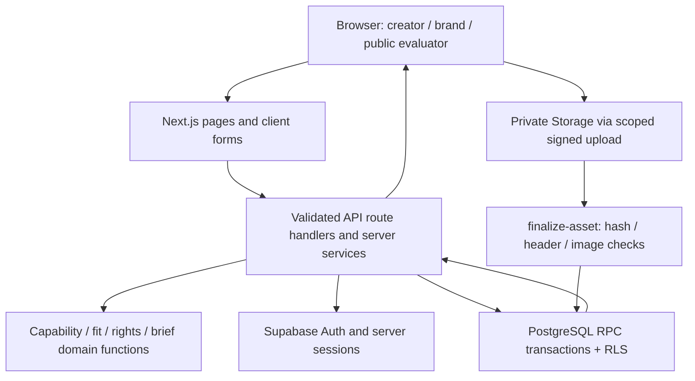

## Architecture

| Layer | Technology | Responsibility | Source |
|---|---|---|---|
| Presentation | Next.js 15 App Router, React 19, TypeScript, Tailwind CSS 4 | Server-rendered pages and client forms; role-aware navigation and responsive interaction. | [src/app](https://github.com/Ritesh004-kira/Creation-Mart/tree/main/src/app) |
| HTTP and sessions | Next.js /api/v1 route handlers, Supabase SSR, Zod | Validated request/response contracts, safe redirects, user validation, origin/body limits and error mapping. | [src/server](https://github.com/Ritesh004-kira/Creation-Mart/tree/main/src/server) |
| Domain logic | Deterministic TypeScript functions | Capability matching, fit-v1 scoring, rights evaluation, media parsing and brief requirement compilation. | [src/domain](https://github.com/Ritesh004-kira/Creation-Mart/tree/main/src/domain) |
| Persistence and transactions | Supabase PostgreSQL; 14 versioned migrations | Profiles, portfolios, briefs, applications, shortlists, engagements, submissions and event records; RPC transitions, RLS, version and concurrency guards. | [supabase/migrations](https://github.com/Ritesh004-kira/Creation-Mart/tree/main/supabase/migrations) |
| Media processing | Private Supabase Storage + finalize-asset Edge Function | Reserve/upload/finalize lifecycle, file hash/header/image checks, ready asset state and authorized signed reads. | [supabase/functions/finalize-asset](https://github.com/Ritesh004-kira/Creation-Mart/tree/main/supabase/functions/finalize-asset) |
| Hosting | Existing Vercel project, Node 22 | Production build, server-rendered web app and HTTP route handlers at the canonical domain. | [vercel.json](https://github.com/Ritesh004-kira/Creation-Mart/tree/main/vercel.json) |

### Data model

accounts links Auth identity to an immutable role. creator_profiles and brand_profiles store role-specific identity. portfolio_items owns assets and claim_signals. briefs owns its requirements, applications and shortlists. Winning application selection creates an engagement with frozen snapshots. submissions stores immutable delivery versions; workflow_events records transitions. catalog_terms supports shared facets and model references; idempotency_keys protects repeat mutations.

### Critical transaction flows

- Upload: reserve an owned asset and quota → upload to its scoped private path → finalize actual bytes → mark ready → publish or map to a submission. Cancelled paths remain blocked until signed-upload expiry.
- Matching: validate filters → apply exact eligibility → calculate normalized fit components → evaluate declaration-based rights → return stable results and explanations.
- Selection: verify owning brand/current brief and application versions → choose one winner atomically → freeze engagement snapshots.
- Delivery: submit owned ready assets against requirements → store immutable version → request referenced revisions → accept latest eligible version → authorize private final read.

## Routes and access

| Route | Access | Function |
|---|---|---|
| `/` | Public | Product landing, core USPs and real navigation. |
| `/project-overview` | Public | Complete evaluator guide, features, architecture, source map and limitations. |
| `/creators and /creators/:slug` | Public / brief context where authorized | Discovery, portfolio passports, fit breakdown and rights receipts. |
| `/sign-in, /onboarding, /account/password` | Public auth / authenticated | Account creation, role assignment and account security. |
| `/dashboard, /creator, /brand` | Authenticated; role-specific | Owned profiles, briefs, applications and engagements. |
| `/creator/profile, /creator/preview, /portfolio/new, /portfolio/:id/edit` | Creator | Profile and portfolio editing, evidence, preview and publication. |
| `/briefs, /briefs/:id` | Published brief visibility / ownership rules | Browse and inspect production requirements. |
| `/briefs/new, /briefs/:id/edit, /briefs/:id/shortlist, /briefs/:id/applications` | Owning brand | Brief creation/publication, candidate comparison and winner selection. |
| `/briefs/:id/apply` | Creator | Current-revision application. |
| `/engagements/:id` | Participants | Submissions, revisions, acceptance and private final downloads. |
| `/api/v1/health` | Public | Database-backed readiness and active assistance mode. |
| `/llms.txt and /project-overview.json` | Public | Plain-text and machine-readable versions of this documentation. |

## HTTP API map

- /api/v1/me/creator and /me/brand: profile persistence; /me/creator/publish: publication.
- /api/v1/portfolio-items and /portfolio-items/:id/publish: portfolio editing and publication; /claims: supporting evidence.
- /api/v1/assets/reserve, /assets/:id/read-url and /assets/:id/cleanup: private media lifecycle and scoped read links.
- /api/v1/creators and /creators/:slug: discovery and creator detail.
- /api/v1/brief-assist and /brief-assist/:id: template assistance; /briefs and /briefs/:id/publish: structured briefs.
- /api/v1/briefs/:id/shortlist and /shortlist/:creatorId: persistent candidate selection.
- /api/v1/briefs/:id/applications, /applications/:id/withdraw and /applications/:id/select: application lifecycle.
- /api/v1/engagements/:id/submissions, /request-revision and /accept: guarded delivery transitions.

The API source is in `src/app/api/v1`; strict schemas are in `src/domain/contracts`; SQL RPCs and database guards are in `supabase/migrations`. Mutations enforce server-side identity and database-level ownership rather than trusting hidden buttons.
